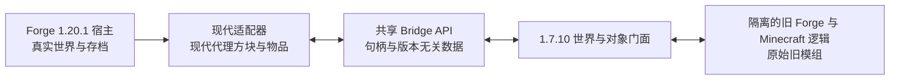

# Forge 1.7.10 → Forge 1.20.1 技术调查

调查日期：2026-10-18（Asia/Tokyo）。范围仅限 Forge 1.7.10 模组运行于 Forge 1.20.1 宿主。

本文依据本地工程、上游文档及抽样源码阅读。没有构建或运行参考项目，没有运行双运行时实验；“源码存在”“上游报告通过”“本项目已验证”分别对待。以下架构与里程碑是建议，不是已经实现的能力。

后续：[第二轮调查：启动、注册屏障与旧对象结构](research-round2/README.md)，补充固定发行产物核对和 Java 17 小型探针；完整双运行时仍未验证。

## 1. 调查结论

建议优先验证 **Java 17 单 JVM、现代 Forge 宿主、隔离的 1.7.10 逻辑运行时、同步 Bridge**。

这个方向有技术依据，但还不足以认定任意旧模组都能运行。现代 Java 支持已有直接参考；真正需要本项目证明的是旧 FML 的嵌入启动、注册阶段协调，以及旧对象对现代世界的完整操作语义。

需要修正前期资料中的四点：

1. **NeoForbric 不是双 Minecraft 运行时方案。**它面向同一 Minecraft 1.21.1，核心是唯一游戏定义域与运行契约适配。本项目借鉴其启动和验证方法，不能照搬游戏对象共享方案。
2. **ClassLoader 隔离没有消除 API 兼容工作。**旧 `World`、`ItemStack`、实体、Chunk 等仍需要真实旧对象、代理或字节码改写，才能访问现代状态。
3. **不能把旧运行时一律延迟到进世界后启动。**需要注册现代方块和物品时，必须赶上宿主相应的注册窗口。
4. **LWJGL3ify 证明现代 JVM 上运行 1.7.10 有成熟参考，不证明可直接嵌入 Forge 1.20.1。**它的独立启动配置和本项目的宿主环境不同。

“原始模组 JAR 不改写，允许加载时在内存转换字节码”是推荐的实现前提，尚不视为用户已经确认的额外约束。若连运行时转换也禁止，必须重新评估覆盖范围和技术路线。

## 2. 本地项目现状

| 项目 | 实际观察 |
| --- | --- |
| Minecraft / Forge | `1.20.1` / `47.4.28` |
| ForgeGradle | `[6.0,6.2)` |
| Gradle wrapper | `8.8` |
| 编译 toolchain | Java 17 |
| 源码 | `src/main/java/github/com/gengyoubo/mfcl` 目录存在，没有 Java 实现 |
| 模组配置 | 仍是 `examplemod`、`com.example.examplemod` 等模板值 |
| 接受的 Minecraft 范围 | 当前 `[1.20.1,1.21)`，比本次固定版本范围宽 |
| 终端默认 Java | `java -version` 指向 Java 8u202 |
| 可用 Java 17 | 显式执行 `.jdks/temurin-17.0.18/bin/java.exe -version` 成功 |
| IDE 配置 | 项目 SDK 是 Temurin 17，Gradle JVM 配置名是 Temurin 21 |
| Git | 当前目录未发现 Git 仓库 |

因此当前是现代 Forge 工程骨架，不能根据已有 `build/` 目录判断兼容层已实现或构建已通过。后续执行实验应显式选择 JDK 17；本次没有修改全局 Java 或 IDE 设置。

依据：本地 `build.gradle`、`gradle.properties`、`gradle/wrapper/gradle-wrapper.properties`、`src/`、`.idea/gradle.xml`、`.idea/misc.xml`，以及上述只读命令。

## 3. 参考项目核实

### 3.1 NeoForbric：借鉴控制权和验证方式

已定位用户给出的 [gengyoubo/NeoForbric](https://github.com/gengyoubo/NeoForbric)，调查固定到 `36ac5b9831f854bc2f3b21c4b5ba5b3415009067`，默认分支 `1.21.1`。

抽查到的实际代码：

- [`GameClassLoader`](https://github.com/gengyoubo/NeoForbric/blob/36ac5b9831f854bc2f3b21c4b5ba5b3415009067/loader/src/main/java/org/neoforbric/loader/GameClassLoader.java) 的 `open()` 要求转换计划已 seal；定义门开启前请求游戏类会失败。
- [`TransformPipeline`](https://github.com/gengyoubo/NeoForbric/blob/36ac5b9831f854bc2f3b21c4b5ba5b3415009067/loader/src/main/java/org/neoforbric/loader/TransformPipeline.java) 按声明依赖排序，seal 后禁止增加转换器，记录输入与输出哈希。
- [`forge-runtime.md`](https://github.com/gengyoubo/NeoForbric/blob/36ac5b9831f854bc2f3b21c4b5ba5b3415009067/docs/forge-runtime.md) 描述同一个游戏定义域中的固定 Forge profile，明确其边界与尚未支持的能力。

它可供本项目借鉴的内容是：被动发现先于入口执行；转换准备先于类定义；固定依赖和映射输入；记录类归属与失败原因；将入口、菜单、世界和功能验证分别统计。

不能照搬“所有生态共用同一个 `ItemStack.class`、传递同一个游戏对象”的要求。1.7.10 与 1.20.1 的结构不同，本项目需要的是跨类型域的对象对应和状态一致性。

仓库早期调查文档中仍有“尚无实现”的历史描述，不能把它当成当前源码状态。反过来，仓库记录的单模组或 profile 测试也不能证明跨版本互操作。[运行模型](https://github.com/gengyoubo/NeoForbric/blob/36ac5b9831f854bc2f3b21c4b5ba5b3415009067/docs/02-runtime-model.md)、[互操作设计](https://github.com/gengyoubo/NeoForbric/blob/36ac5b9831f854bc2f3b21c4b5ba5b3415009067/docs/17-cross-ecosystem-interoperability.md)、[实验报告](https://github.com/gengyoubo/NeoForbric/blob/36ac5b9831f854bc2f3b21c4b5ba5b3415009067/ItemReport.md)应结合实际代码阅读。

### 3.2 LWJGL3ify / RetroFuturaBootstrap：直接参考 1.7.10 现代化

[LWJGL3ify](https://github.com/GTNewHorizons/lwjgl3ify) 明确面向 Minecraft 1.7.10 与 Java 17+；其 README 列出启动依赖、反射开放、LWJGL 调用重定向及模组兼容补丁。它也明确指出，部分模组仍需要额外修复，不能将“旧 class 可被 JVM 接受”理解成完整兼容。

[RetroFuturaBootstrap](https://github.com/GTNewHorizons/RetroFuturaBootstrap) 是 LaunchWrapper 的兼容替代实现，提供早期转换插件。对本项目而言，启动与转换部分比窗口系统更值得优先研究。

尤其不能直接复制整个启动配置：RFB [`Main`](https://github.com/GTNewHorizons/RetroFuturaBootstrap/blob/master/src/main/java/com/gtnewhorizons/retrofuturabootstrap/Main.java) 默认检查系统类加载器是否是 `RfbSystemClassLoader`，同时提供 `rfb.skipClassLoaderCheck` 分支。**存在跳过检查的分支，并不代表已支持嵌入现代 Forge。**它仍有静态启动状态和类加载链需要审计。

建议先在独立探针中验证一种受控的旧版启动方式，再研究嵌入。不应在现代宿主内直接调用旧 `main()`，也不应让旧启动器接管宿主系统类加载器。

### 3.3 Cleanroom：现代化方法参考

[Cleanroom](https://github.com/CleanroomMC/Cleanroom) 主要面向 1.12.2；当前官方资料介绍 Java 25。可借鉴其启动、依赖更新与兼容补丁思路，但它不是现成的 1.7.10 逻辑运行时，也不是本项目的依赖替换方案。[官网](https://cleanroommc.com/)、[Java 参数说明](https://cleanroommc.com/wiki/end-user-guide/args)。

本项目固定宿主 1.20.1，首轮实验采用 Java 17，减少变量。没有必要因为参考项目使用更高 Java 就同时升级本项目目标。

### 3.4 UniversalModBridge：最接近跨版本运行的源码参考

[UniversalModBridge](https://github.com/gato001k1/UniversalModBridge) 调查固定到 `b24a6378b58db5b7c4581456b38e74c02deb8a8b`。它的宿主是 Minecraft 26.2，要求 Java 25，自称 very early alpha；不能直接作为 Forge 1.20.1 依赖。

这次不仅看了 README，也抽查了实现：

| 文件 | 源码中可确认的内容 | 本次证据的限制 |
| --- | --- | --- |
| [`LegacyLoader`](https://github.com/gato001k1/UniversalModBridge/blob/b24a6378b58db5b7c4581456b38e74c02deb8a8b/umb-legacy/src/boot/java/dev/umb/legacy/boot/LegacyLoader.java) | 继承 `LaunchClassLoader`，旧类优先，公共 API 委托，共享类型归属受控 | 没有在本项目宿主中执行 |
| [`LegacyDriver`](https://github.com/gato001k1/UniversalModBridge/blob/b24a6378b58db5b7c4581456b38e74c02deb8a8b/umb-legacy/src/legacyside/java/dev/umb/legacy/legacyside/LegacyDriver.java) | 调用真实 FML 的 `loadMods`、`preinitializeMods`、`initializeMods`，重建部分启动步骤 | 不等于原生旧启动链完全等价 |
| [`UmbWorld`](https://github.com/gato001k1/UniversalModBridge/blob/b24a6378b58db5b7c4581456b38e74c02deb8a8b/umb-legacy/src/legacyside/java/dev/umb/legacy/legacyside/UmbWorld.java) | 将旧版 SRG 世界方法转发到 `HostWorld`；使用特殊对象分配与字段初始化 | 未覆盖旧世界的所有语义 |
| [`UniverseRootLoader`](https://github.com/gato001k1/UniversalModBridge/blob/b24a6378b58db5b7c4581456b38e74c02deb8a8b/umb-hostagent/src/main/java/dev/umb/hostagent/content/UniverseRootLoader.java) | 为旧日志依赖增加一个隔离层 | 说明实际实现不止“两个 URLClassLoader” |
| [`LegacyLoaderTest`](https://github.com/gato001k1/UniversalModBridge/blob/b24a6378b58db5b7c4581456b38e74c02deb8a8b/umb-legacy/src/test/java/dev/umb/legacy/test/LegacyLoaderTest.java) | 包含同名游戏类隔离、JDK 委托及 API 身份测试 | 存在测试代码不等于本次测试运行通过 |

一个具体的语义缺口值得注意：其 `UmbWorld` 的六参数 `setBlock` 转发后直接返回 `true`。这只能证明转发存在，不能证明失败、越界或区块不可写时的返回值与旧世界一致。

可以研究其“真实旧对象 + 现代代理对象 + 世界门面”，但不能引用作者展示作为本项目对大型模组的兼容承诺。

## 4. 建议架构

这是两个游戏类型域，不限定实际只有两个 ClassLoader。现代游戏定义权继续属于现代 Forge；本项目控制旧域的输入与转换链，不重新设计现代 Forge 的完整启动器。

| 模块建议 | 职责 |
| --- | --- |
| `bridge-api` | 仅依赖 JDK；稳定句柄、坐标、内容标识、结果和异常契约 |
| `host-forge1201` | 现代入口、注册阶段接入、线程与世界绑定、宿主代理 |
| `legacy-bootstrap` | 输入校验、旧域加载、转换准备、阶段驱动、审计 |
| `legacy-forge1710` | 真实旧类型上的世界/玩家门面和旧 FML 适配 |
| `fixtures` | 使用旧 Forge 构建的测试模组，以及对照运行记录 |

模块初期可以是独立 source set 或子项目，重点是编译和运行依赖边界，不是先把目录做大。

### 4.1 类加载与公共 API

**公共 API 必须由双方可见的同一个定义者提供。**两边各定义一份相同接口，仍然不是相同 JVM 类型。旧域应把指定 Bridge 包委托给共享定义者，现代宿主也使用这同一份定义。

旧 `net.minecraft.*`、`cpw.mods.fml.*`、旧 `net.minecraftforge.*` 及相应依赖由旧域拥有。现代 Forge 也有 `net.minecraftforge.*`，不能按包名相似就共享。

建议使用显式 owner 规则：旧游戏类不存在时，在旧域报错，不回退取得现代同名类；JDK 类型来自 JVM；共享 Bridge 类型来自指定定义者；其他库按依赖及 SPI 签名决定归属。资源、`META-INF/services`、TCCL 与反射查找也需遵循边界。

JVM 类型身份依据是二进制类名与定义它的加载器，见 [JVMS §5.3](https://docs.oracle.com/javase/specs/jvms/se17/html/jvms-5.html#jvms-5.3)。

### 4.2 类型代理不等于 Java 动态代理

旧模组引用的是旧 `World`、`WorldServer`、`ItemStack` 等具体类。仅定义 `UnifiedWorld` 接口不会让它们自动兼容；Java 动态代理也不能代理任意具体类。

需要选择并验证：继承真实旧类并覆盖方法、改写旧调用点/旧基础类，或受控构造旧门面对象。绕过构造器的特殊分配会遗漏字段和不变量，不能把它当成通用捷径。

旧模组还可能直接访问字段、访问 Chunk、反射寻找具体类，绕过已有方法门面。必须由真实样本决定覆盖范围，缺失能力应明确报错，不能普遍用 `null`、空气或成功值代替。

### 4.3 世界只有一个权威来源

真实方块、玩家、碰撞和存档由 1.20.1 拥有；旧机器对象可保留自身逻辑状态，但不再独立运行一份完整地形世界。

第一个可用契约应是：在现代服务器线程执行旧回调；旧 `setBlock` 同步修改真实世界；随后的 `getBlock` 立即看到结果。还需验证返回值、更新 flags、邻居通知和重入。

异步线程请求不能简单“发送后返回成功”。首版可明确拒绝不支持的线程访问。以后若排队等待主线程，必须分析主线程等待旧线程造成的死锁。

两边的对象由稳定句柄对应，缓存需包含世界实例或代次；维度卸载、重新进世界、方块移除时失效。不要让静态缓存把上一轮世界或玩家保留下来。

### 4.4 映射解决名称，适配解决结构

旧发行模组的 Minecraft 引用、旧原版混淆类、SRG/MCP 开发命名与 Forge 二进制补丁必须组成一套一致的运行输入。不能只做类名替换，也不能把开发环境加载成功当成发行模组加载成功。

推荐固定旧 Forge `10.13.4.1614` 作为首个候选基线，与宿主 `47.4.28` 一起记录版本、来源和哈希；这只是缩小实验范围，不声明所有 1.7.10 模组都要求或兼容这个基线。

可以在缓存中准备旧游戏运行输入；输入模组 JAR 保持原始哈希。运行时转换另记录输入哈希、映射版本、转换器顺序和输出哈希。

## 5. 生命周期和注册表是两个不同问题

真实旧 FML 不只是三个事件类。它还涉及发现、依赖排序、构造、实例与代理注入、活动 ModContainer、配置和事件总线。旧 [`Loader`](https://github.com/MinecraftForge/FML/blob/1.7.10/src/main/java/cpw/mods/fml/common/Loader.java) 的 `loadMods`、`preinitializeMods`、`initializeMods` 展示了实际阶段。

建议 M1 优先驱动真实旧 FML 的受控路径。若先写最小注解/事件模拟器，应把它称为链接探针，不能把三次反射调用描述成 Forge 兼容已经实现。

宿主静态注册表则必须在 `RegisterEvent` 等合法窗口写入，见 [Forge 1.20.1 注册表文档](https://docs.minecraftforge.net/en/1.20.1/concepts/registries/)。因此不能简单把旧 PreInit 放到现代 common setup，再将捕获到的方块补注册。

M2 需要专门验证以下协调流程，而不是提前认定它成立：

1. 在宿主有关注册窗口关闭之前，旧域完成产生该类注册内容的阶段。
2. 旧域保留真实旧注册对象，Bridge 记录声明并生成现代注册计划。
3. 在宿主对应窗口创建并绑定现代代理对象。
4. 后续阶段只做各自允许的操作；晚于宿主窗口出现的新内容应明确失败。

需要检查旧模组在 Init/PostInit 注册内容，以及初始化时查询现代对象的情况。不能靠执行两次旧生命周期来“先预扫描再重放”，否则副作用和对象身份会改变。也不能假定每个模组都能只凭静态扫描预先知道全部注册内容。

双向互操作还多一个容易遗漏的问题：旧域原本不存在现代模组的方块类。旧 `getBlock` 要返回什么？受限原版映射可以先做；通用支持需要旧域的反向代理及行为契约，不能把未知现代方块全部当空气。

metadata、现代 BlockState、方块实体附加状态之间也未必可逆。先按固定测试内容建立映射，不承诺一个 metadata 通用转换器覆盖所有模组。

## 6. 第一阶段验收建议

| 里程碑 | 目标 | 通过所需证据 |
| --- | --- | --- |
| M0：类型与转换隔离 | Java 17 上在隔离旧域加载夹具；现代 Forge 能正常启动 | 同名类来自不同域；Bridge 接口是同一个 Class；旧转换器不接收现代类；输入哈希不变 |
| M1：原始旧模组生命周期 | 使用旧 Forge 构建并做过对照运行的无内容测试 JAR，在现代宿主中完成旧 FML 加载 | 构造及 PreInit → Init → PostInit 顺序正确、各一次；模组未重编译；发行命名输入；完整异常与类来源日志 |
| M1b：真实世界读取 | 旧代码经旧 World 门面读取现代世界时间 | 主线程执行；结果与宿主一致；退出重进后没有复用旧世界句柄 |
| M2：注册与读写闭环 | 一个简单旧方块/物品具有现代代理，可在真实世界操作 | 注册早于窗口关闭；写后立即读一致；双方操作可见；保存重载正确 |
| M3：旧方块实体 | 一个旧计数器或机器由宿主驱动 | 每 Tick 恰好一次；NBT 保存重载；区块卸载/加载；不重复执行逻辑 |

M1 测试模组可以不注册自定义方块或物品，但保留真实旧运行时所需的原版注册和基础初始化。先限制为普通 Java 模组、无 CoreMod、无客户端专属初始化；这是测试覆盖边界，不是后续永远不支持客户端。

M0 的合成夹具只能证明类型隔离；M1 的独立旧启动只能证明旧域可运行。最终必须在**真实 Forge 1.20.1 启动链中**复验，才满足项目第一个里程碑。

M2 是进入大型模组适配前的架构关卡。如果注册协调无法在宿主正常生命周期内实现，再凭日志决定是否需要更早的 ModLauncher 扩展；目前不先引入 Java agent 或另写完整启动器。

## 7. 暂不纳入首轮实验的内容

- 1.12.2、1.18.2、Fabric、NeoForge 等其他目标。
- 任意 CoreMod/Mixin 的通用兼容，旧优化模组和旧启动器接管。
- 旧 OpenGL 渲染、GUI、音效、完整实体 AI 和世界生成。
- 直接以神秘时代 4、IC2 或 GTNH 等复杂模组/整合包作为第一个验收样本。
- 原版 1.7.10 客户端连接现代宿主的网络协议兼容。

后续多人联机仍需现代客户端与服务器间的真实传输、方向、握手、注册同步和线程契约。进程内消息转发只适合对应的本地路径，不能推广成“所有网络包都不出进程”。

同一个 ClassLoader 内的静态状态可以隔离，但系统属性、部分日志/服务设施、原生库和 JVM 退出行为并非天然按 ClassLoader 隔离。旧转换链只作用于旧域是必要条件，不能由此宣称任意旧 CoreMod 已被安全封装。

## 8. 后续实施顺序

先固定输入与 Java 17，做 M0/M1；通过后增加最小世界门面，再做注册窗口探针。优先复用“受控真实旧逻辑”思路，把必须补的旧环境行为集中在旧适配器。

暂不引入 Cleanroom 整套运行时或完整 LWJGL3ify 图形栈。NeoForbric 用于参考准备屏障、审计和验证组织；UniversalModBridge 用于参考跨版本门面设计；实际宿主集成按 Forge 1.20.1 的加载与注册契约独立验证。

本次仅新增这份调查资料，没有修改构建、模组元数据或运行配置，也没有宣称任何实验通过。
